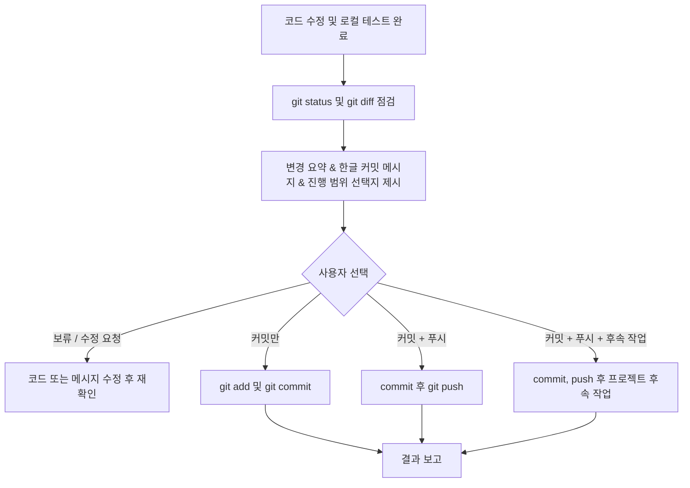

# samjil-git-commit

Git 커밋(`git commit`) 및 푸시(`git push`)를 안전하고 투명하게 수행하기 위한 표준 워크플로 규약입니다.
에이전트는 사용자의 명시적인 사전 허락 없이 절대로 임의로 커밋하거나 푸시해서는 안 됩니다.

---

## 4대 핵심 원칙

1. **사전 승인 필수 (임의 커밋 절대 금지)**
   - 코드 작업이 끝났다고 해서 곧바로 `git commit`을 실행하지 않습니다.
   - 변경된 파일 목록(`git status`), 주요 변경 요약, 그리고 **한글 커밋 메시지**를 사용자에게 먼저 제시하고 명시적인 승인을 구합니다.

2. **커밋 메시지 한글 작성 원칙**
   - 커밋 메시지(comment)는 항상 명확하고 이해하기 쉬운 **한글**로 작성합니다.
   - 접두사는 Conventional Commits(`feat`, `fix`, `refactor`, `docs`, `style`, `test`, `chore`) 형식을 따릅니다.
   - 예시:
     - `feat(viewer): serve-viewer 실행 시 agy 워처 자동 감지 및 기동 기능 추가`
     - `fix(delegate): Windows PowerShell 5.1 한글 인코딩 깨짐 방지를 위한 UTF-8 BOM 복원`
     - `refactor(scripts): 내부 스크립트를 sub/ 폴더로 분리하고 start/stop만 루트 유지`

3. **커밋 이후 작업도 승인 질문 한 번에 고른다**
   - 커밋 승인을 구할 때 "어디까지 진행할지"를 선택지로 함께 묻습니다. 커밋 뒤에 푸시 · 후속 작업을 다시 묻지 않습니다(불필요한 재확인과 재읽기 방지).
   - 선택지는 현재 상황에 맞는 것만 제시합니다(아래 "진행 범위 선택지").

4. **선택한 범위까지만 수행**
   - 사용자가 고른 범위의 작업만 순서대로 실행합니다. 고르지 않은 후속 작업(푸시 등)은 하지 않습니다.
   - 어느 단계에서든 실패하면 그 자리에서 멈추고 결과를 보고합니다(푸시 실패 시 재시도 · 강제 푸시 금지).
   - 거절하거나 보류하면 아무것도 커밋하지 않습니다.

---

## 진행 범위 선택지

승인 질문(가능하면 `AskUserQuestion` 선택 팝업)에 아래 중 상황에 맞는 것만 넣습니다. 첫 번째가 추천입니다.

| 선택지 | 실행 내용 | 넣는 경우 |
|---|---|---|
| 커밋만 | `git add` + `git commit` | 항상 |
| 커밋 + 푸시 | 위 + `git push origin <branch>` | 원격 저장소가 있을 때 |
| 커밋 + 푸시 + 프로젝트 후속 작업 | 위 + 프로젝트가 정해 둔 후속 작업 | 후속 작업이 정의돼 있고 이번 변경이 해당될 때 |
| 커밋 + 프로젝트 후속 작업 | 푸시 없이 후속 작업만 | 위와 같고 푸시는 보류할 때 |
| 보류 | 아무것도 하지 않음 | 팝업의 Other 로 입력받음 |

- **프로젝트 후속 작업**은 프로젝트 지침(`CLAUDE.md`, README, 메모리 등)에 적힌 것만 씁니다. 추측해서 만들지 않습니다. 예: 이 저장소의 설치본 동기화(`sync-installed.ps1`, 워처 스크립트가 바뀌었으면 일 없을 때 `-RestartWatcher`). 이번 변경이 해당하지 않으면(예: 문서만 수정) 그 선택지는 넣지 않습니다.
- PR 생성은 이 스킬 범위가 아닙니다. 푸시까지만 하고, 사용자가 요청하면 별도로 처리합니다.
- 선택지가 4개를 넘으면 가장 가능성 높은 것만 남기고 나머지는 Other 로 받습니다.

---

## 표준 워크플로 절차



### Step 1. 변경 사항 점검 및 한글 커밋 메시지 준비
- `git status`로 변경/추가된 파일을 확인합니다.
- `git diff`로 실제 수정된 코드가 의도한 대로 정확한지 확인합니다.
- 변경 목적을 명확히 설명하는 **한글 커밋 메시지**를 작성합니다.
- 푸시 가능 여부(원격 · 브랜치)와 프로젝트 후속 작업 해당 여부도 이때 함께 확인해 선택지를 정합니다.

### Step 2. 사용자에게 승인 및 진행 범위 질문 (대기)
변경 파일 · 요약 · 한글 커밋 메시지를 보고하고, 진행 범위를 선택지로 묻습니다:
> **변경 파일**: `runtime/viewer/serve-viewer.ps1`  
> **변경 요약**: 뷰어 실행 시 워처가 켜져 있지 않으면 자동으로 감지하여 새 콘솔 창으로 띄우는 기능 추가  
> **한글 커밋 메시지**: `feat(viewer): serve-viewer 실행 시 agy 워처 자동 감지 및 기동 기능 추가`  
>  
> 어디까지 진행할까요? (커밋만 / 커밋 + 푸시 / 커밋 + 푸시 + 후속 작업 / 보류)

### Step 3. 선택한 범위를 순서대로 실행
```powershell
git add <대상파일>
git commit -m "한글 커밋 메시지"
git push origin <branch>                                  # 푸시를 골랐을 때만
<프로젝트 후속 작업>                                       # 후속 작업을 골랐을 때만 (예: sync-installed.ps1)
```
- 각 명령은 앞 단계가 성공했을 때만 이어서 실행합니다.
- 커밋 · 푸시 · 후속 작업 결과를 한 번에 모아 보고합니다(커밋 해시, 푸시 대상 브랜치, 후속 작업 결과).
